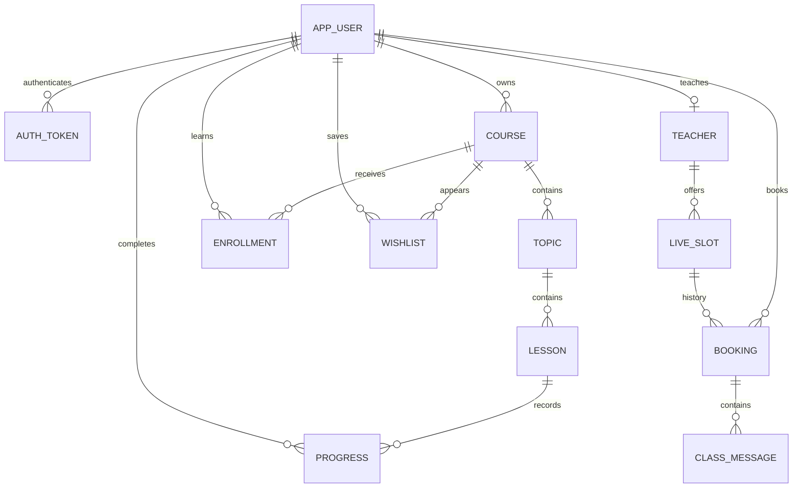

# Code guide and design

[README](../README.md) | [Development guide](development.md) | [API reference](api.md) | [Frontend integration](frontend-integration.md)

For a first read, follow `SikaiApplication` -> `SecurityConfig` -> a feature controller -> its service -> `Db`.
Use the development guide for the request sequence and extension steps, and the API reference for client contracts.

## Structure

All Java classes are under `src/main/java/com/sikai`. JavaDoc explains the class responsibility; SQL is parameterized and checked into source for direct review.

| File | Responsibility |
| --- | --- |
| `SikaiApplication` | Spring Boot entry point and component discovery |
| `SecurityConfig` | Authorization-header filter, public route allowlist, admin restriction, CORS, stateless sessions |
| `AuthController` | Validates registration/login JSON and exposes session endpoints |
| `AuthService` | Email normalization, BCrypt password checks, 256-bit opaque tokens, SHA-256 token digests, expiry and revocation |
| `Bootstrap` | Optional first-run administrator provisioning |
| `Db` | Small JdbcTemplate adapter for queries, required-record reads, generated numeric keys and consistent JSON column labels |
| `CatalogController` | Catalog, instructor course mutations, administrator listings and counts |
| `CatalogService` | Course field validation, category taxonomy, publication visibility, ownership and enrollment authorization |
| `ContentController` | Topics/lessons, timestamp validation, multipart upload and authenticated binary response |
| `LearningController` | Authenticated user's wishlist, free enrollment and progress |
| `LiveController` | Scheduling HTTP layer and confirmation trigger after booking commit |
| `LiveService` | Teacher profiles, slots, participant authorization, booking conflicts, atomic reschedule, cancellation and messages |
| `ConfirmationService` | Optional SMTP delivery from authoritative saved booking data |
| `ApiErrors` | Safe uniform error responses and internal unexpected-error logging |

Configuration lives in `application.yml`; schema evolves through `db/migration`. `categories.json` mirrors the current frontend taxonomy without modifying it. Avoid editing an applied Flyway migration; add `V2__description.sql` for changes.

## Data relationships

Users have one role: student, instructor or admin. An instructor is allowed to learn too. Password hashes and token digests are separate from public user projections. Course ownership is derived from the signed-in principal, not request payloads. Composite primary keys prevent duplicate wishlists, enrollments and completed lessons.

## Security and transactions

The filter authenticates an opaque token by looking up its digest and expiry. Every request reconstructs the current role from the database. Tokens are not cookies, so CSRF is disabled; CORS is restricted to configured origins. HTTP authorization protects admin paths, while services enforce ownership and booking participation.

Scheduling mutations call `SELECT ... FOR UPDATE` on the single `schedule_mutex` row inside `@Transactional` service methods. This serializes check-and-write operations across threads and backend instances using the same database. A reschedule checks the destination while excluding the replaced booking and then performs cancellation/insertion in one transaction. Failure rolls back both changes. This favors correctness and simplicity over high scheduling throughput. At larger scale, replace the global mutex with carefully ordered participant locks or PostgreSQL exclusion constraints, preserving concurrent tests.

Enrollment, wishlist addition and progress completion lock the user row before checking/inserting. Database uniqueness remains the final protection. Emails are sent after the booking service transaction returns; SMTP failure cannot undo the transaction. No outbox or automatic retry is included.

Upload keys are generated UUIDs. Client filenames are metadata only and cannot select disk paths. Downloads check course ownership/enrollment before resolving a file. Allowed MIME types and maximum size are checked, but MIME declarations are not deep file inspection. Add scanning before accepting untrusted public uploads. File writes and database transactions are not a single atomic resource; a crash/rollback can leave an unreferenced file. Replaced/detached/deleted lesson binaries are retained. A future garbage collector should compare stored keys with `lesson.file_key`, skip recently created files and remove only validated paths under the upload directory.

## Testing

`PlatformIntegrationTest` runs Spring's real application context, SecurityFilterChain, Flyway and JDBC against an isolated in-memory H2 database. It tests registration privilege rejection, logout revocation, admin access, course ownership, enrollment/media access, learning state, paid-course blocking, meeting privacy, rescheduling/cancellation/messages and competing booking requests. Test uploads are confined to `target/test-uploads`.

Run `mvn clean verify`. Docker/PostgreSQL configuration is supplied, but PostgreSQL should also be exercised in your deployment pipeline; H2 compatibility mode does not replace testing the actual production database. Package compilation and H2 tests do not validate SMTP credentials or real email delivery.

## Operations and extension points

Back up the database and upload directory together; PostgreSQL deployments use the Compose `database` and `media` volumes. Use absolute upload paths in server deployments. Multiple instances need shared media storage; file-backed H2 is intended for one local process. Use PostgreSQL for multi-instance deployments.

Only basic health is exposed through Actuator. Query APIs use bound arguments; no request-controlled SQL fragments are interpolated. Catalog pagination is bounded; private course/user/booking lists are currently unpaginated. Add pagination before large datasets. Add application-level audit trails, account recovery/verification, token cleanup scheduling, rate limits and metrics according to deployment requirements.

For payments, add provider-created checkout sessions and signature-verified idempotent webhooks. Grant enrollment only from a verified server-side payment event. For reviews, add a persisted enrollment-linked review model and compute ratings; do not let clients assign aggregate rating values. For realtime messaging, preserve participant checks when adding WebSocket delivery. For media streaming, add authenticated range support or short-lived signed storage URLs rather than publishing upload directories.
