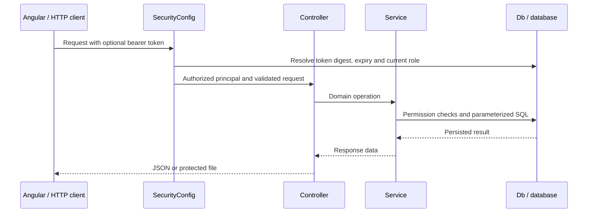

# Backend development guide

[README](../README.md) | [Architecture](architecture.md) | [API reference](api.md) | [Frontend integration](frontend-integration.md)

## Read one request from start to finish



Some small personal-learning and content operations live directly in controllers. Their shared access rules still come from `CatalogService`, and JDBC operations participate in Spring transactions when the route is annotated `@Transactional`.

## Where to make changes

| Change | Files to read first |
| --- | --- |
| Registration, login, expiry or logout | `AuthController`, `AuthService`, `SecurityConfig` |
| First-run administrator provisioning | `Bootstrap` |
| Public catalog, filters or ownership | `CatalogController`, `CatalogService` |
| Topic/lesson metadata, chapters or files | `ContentController` |
| Wishlist, enrollment or progress | `LearningController` |
| Booking conflicts, replacement or cancellation | `LiveController`, `LiveService` |
| Confirmation email | `ConfirmationService` |
| Query mapping and generated keys | `Db` |
| Error response shape | `ApiErrors` |
| Schema changes | `src/main/resources/db/migration/` |

Source files are under `src/main/java/com/sikai/`. `target/classes/` contains copied/compiled build output. Edit the source migration under `src/main/resources/db/migration/`, never the copy under `target/classes/`.

## Add an endpoint

1. Define the input record and its Bean Validation rules. Keep server-controlled ownership, role escalation and aggregate fields out of editable input.
2. Decide its HTTP method and route. Add public access to `SecurityConfig` only when the resource should be public.
3. Resolve identity through `@AuthenticationPrincipal`; do not trust a submitted user ID for ownership.
4. Reuse `CatalogService` ownership/content checks or `LiveService` participant checks before querying private data.
5. Use parameterized SQL through `Db`. Avoid interpolating request input into SQL fragments.
6. Put dependent checks and writes inside a transaction. Add a lock when simultaneous requests could both pass a check.
7. Return a deliberate status and safe message for domain failures. Leave unexpected internals to server logs.
8. Update [api.md](api.md), the frontend service mapping and integration tests when the contract changes.

`Db.require(condition, status, message)` raises a `ResponseStatusException` for an expected business-rule failure. `Db.one()` raises 404 for a missing required record. Database constraint violations are translated to 409 by `ApiErrors`.

## Data conventions

| Value | Representation |
| --- | --- |
| Course and lesson IDs | Database-generated numeric IDs |
| Other domain IDs | UUID strings |
| Slot, message and session times | Epoch milliseconds |
| Media duration and chapter times | Seconds |
| Slot duration input | Minutes |
| Course duration | Hours |
| Prices | `BigDecimal`, up to two decimal places |
| Account roles | `student`, `instructor`, `admin` |

SQL columns use snake_case. Public response aliases use camelCase, such as `ownerId` and `durationHours`. `Db.list()` normalizes unquoted uppercase H2 labels to lowercase while preserving quoted camelCase aliases, keeping responses consistent across supported driver configurations.

## Transactions and concurrency

### Learning state

Wishlist additions, free enrollment and lesson completion lock the user's row before checking and inserting. Composite keys provide a final uniqueness constraint. PUT operations are idempotent: repeating the same request does not toggle the value.

### Scheduling

Scheduling writes lock `schedule_mutex` with `SELECT ... FOR UPDATE` inside a transaction. Conflict queries and mutations therefore run as one serialized operation across threads and instances sharing the database.

Rescheduling excludes the old booking while checking the new slot. Only after checks pass does the transaction cancel the old record and insert the new one. A failed request rolls back both changes. Keep this order when changing scheduling behavior.

`LiveService.messages()` is an internal query, not a stand-alone authorization boundary. HTTP callers first use `participant()`; the booking list calls it only for bookings already restricted to the current participant.

### Email and uploaded files

Email is sent after the booking transaction returns. SMTP disabled/failure is reported separately so it cannot undo a confirmed class. No delivery outbox or automatic retry is implemented.

Files use generated storage keys. Filenames are metadata, and download access is checked before resolving disk paths. MIME type checks are an allowlist, not deep content verification. File and database writes are not one atomic resource; replaced/detached/deleted binaries are retained for a future cleanup process.

## Change the schema safely

Flyway applies versioned migrations at startup. Add a new migration such as `V2__add_review_table.sql`; do not change a migration already applied to a persistent database.

Keep SQL compatible with the configured H2/PostgreSQL modes or clearly document a database-specific migration strategy. Test against PostgreSQL before relying on production behavior; H2 does not prove full dialect parity. Back up database records and lesson files together.

## Comments and API documentation

Explicit methods and constructors have JavaDoc explaining purpose and relevant authorization, units, transaction or cleanup behavior. Keep that documentation with the implementation. Request/response details belong in [api.md](api.md); operational configuration belongs in the README. Prefer comments explaining a non-obvious constraint over line-by-line narration.

When a method returns a notice rather than throwing, document that distinction. For example, a disabled confirmation email is not a failed booking. When a helper assumes earlier authorization or an active transaction, keep that precondition visible in its comment.

## Build and test

Run from `sikai-backend`:

```powershell
mvn verify
```

`PlatformIntegrationTest` starts the real Spring context, security filter, Flyway and JDBC adapter against an isolated in-memory H2 database. It covers:

| Test | Main checks |
| --- | --- |
| `authenticationAndRoles` | Health, malformed IDs, privilege rejection, login failure, admin access and token revocation |
| `catalogLearningAndProtectedFiles` | Course ownership, curriculum, file upload/access, free enrollment, progress, wishlist and paid-enrollment blocking |
| `liveBookingPrivacyReschedulingAndCancellation` | Private links, overlap rejection, participant messages, replacement and cancellation |
| `concurrentBookingHasExactlyOneWinner` | Two simultaneous attempts produce one successful booking and one conflict |

The H2 test URL intentionally allows uppercase unquoted column labels so response normalization is exercised. Test uploads stay under `target/test-uploads`. The packaged JAR is then used by the separate Angular browser tests; see the [frontend testing guide](../../sikai-frontend/docs/testing.md).

Tests do not verify real SMTP credentials or a live PostgreSQL deployment. Docker configuration is supplied, but its runtime must be checked in the deployment environment.
